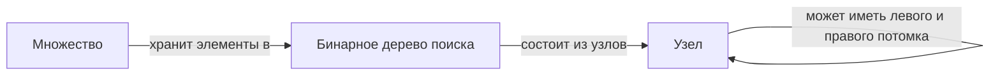
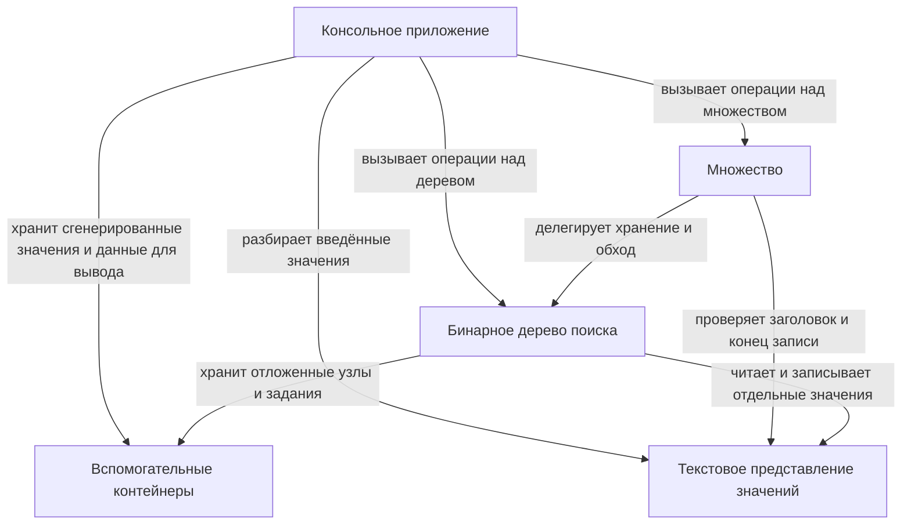
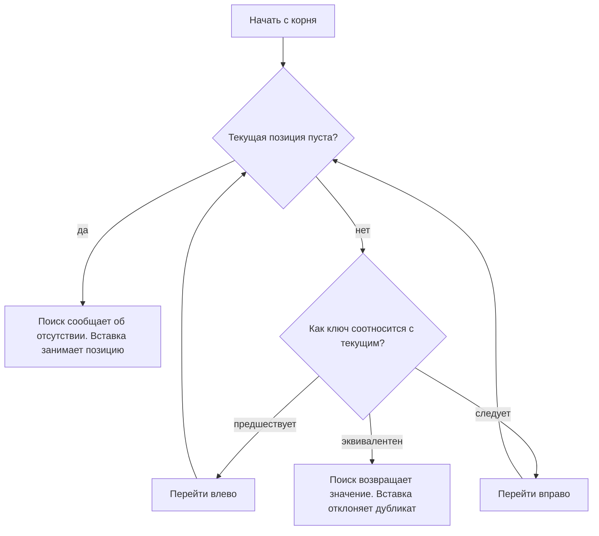
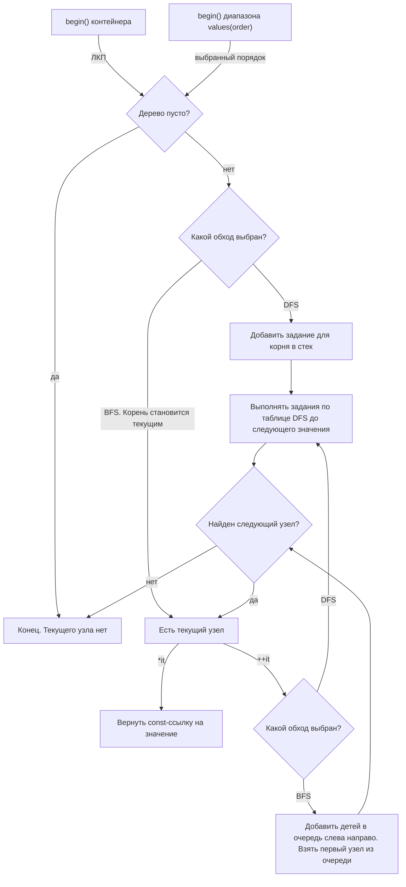

# Дизайн лабораторной работы № 1. Дерево поиска и множество

## 1. Постановка задачи

### 1.1. Идея 
Разработать библиотеку для работы с бинарным деревом поиска и множеством, а также консольную программу для демонстрации их операций. Библиотека должна поддерживать разные типы значений и заданное пользователем правило сравнения. В демонстрации используются целые и вещественные числа, строки, записи о студентах и комплексные числа.

### 1.2. Область применения
Дерево поиска подходит для задач, в которых данные пополняются и удаляются, а пользователю нужно находить записи по ключу и просматривать их в заданном порядке. С помощью множеств можно сравнить группы уникальных значений, например найти общие идентификаторы в двух списках или выяснить, какие идентификаторы есть только в первом списке. Извлечение поддерева и восстановление из текста позволяют работать с формой дерева и сохранять её между сеансами.


## 2. Сущности прикладной задачи и их связи

| Сущность | Описание |
|---|---|
| Узел | Элемент дерева, в котором хранится одно значение. У узла может быть левый и правый потомок. |
| Бинарное дерево поиска | Иерархия узлов. Ключи в левой ветви предшествуют ключу узла, а в правой следуют за ним согласно заданному порядку. У непустого дерева один корень. |
| Множество | Совокупность значений, уникальных по ключу. Включение и равенство множеств определяются их составом. |



## 3. Архитектура

### 3.1. Компоненты системы

| Компонент | Описание |
|---|---|
| Консольное приложение | Управляет вводом, меню и представлением результатов. |
| Бинарное дерево поиска | Хранит узлы, поддерживает порядок ключей и предоставляет операции над деревом. |
| Множество | Предоставляет операции над уникальными ключами и использует дерево как хранилище. |
| Вспомогательные контейнеры | Динамический массив, стек и очередь для временных данных и состояния обходов. |
| Текстовое представление значений | Преобразует отдельные значения в текст и обратно, обрабатывает токены формата. |

### 3.2. Связи между компонентами



### 3.3. Описание компонентов, алгоритмов и ключевых решений

- **Узлы и порядок в дереве.** Корень и дочерние связи хранятся в `std::shared_ptr`, чтобы итератор и рабочие задания могли временно удерживать узлы. Родитель запоминается только на время операции. Дерево хранит экземпляр `Compare` для поиска и определения эквивалентности ключей. Балансировка не применяется, поэтому при построении форма отражает порядок вставки.
- **Доступ к значениям.** Внутренний поиск работает с узлом, а публичный `find` возвращает необязательную константную ссылку на значение. Это позволяет читать запись без копирования и сохраняет управление узлами внутри дерева. Поиск использует эквивалентность ключей, а сравнение поддеревьев дополнительно проверяет полное равенство записей. У двух студентов с одним ID, например, могут различаться имена.
- **Удаление и очистка.** Узел с двумя детьми заменяется переносом преемника из правой ветви. Переназначение связей позволяет сохранить адреса остальных значений и обойтись без присваивания `T`. При очистке левый потомок поднимается поворотом, а корень без левого потомка отсоединяется после переноса правой связи. Так глубокая цепочка освобождается итеративно, без дополнительных выделений памяти.
- **Присваивание и компаратор.** Копия дерева или компаратора готовится до очистки получателя. Новый компаратор устанавливается перед передачей корня, чтобы получатель не сохранил старые узлы при смене порядка. При перемещении компаратор копируется, поэтому исходный объект сохраняет своё правило сравнения для повторного использования.
- **Обходы и итератор.** Шесть порядков DFS задаются строками общей таблицы действий. Итератор хранит текущий узел и отложенные задания в стеке, а для BFS использует очередь узлов. Продвижение вычисляет следующую позицию по мере запроса. `for_each` использует тот же диапазон, поэтому обработка значений переиспользует логику итератора.
- **Поддеревья и преобразования.** При копировании стек сопоставляет исходные узлы с уже созданными копиями. Это сохраняет расположение дочерних связей. Поиск вхождения начинает с единственного кандидата по ключу корня и сравнивает соответствующие ветви попарно. Для `map` и `where` используется обычная вставка в новое дерево, чтобы после преобразования и отбора действовало то же правило упорядочения ключей.
- **Множество.** `OrderedSet` хранит `SearchTree` как поле. Объединение добавляет элементы второго множества к копии первого, а пересечение и разность используют `where` с проверкой принадлежности. Так для всех операций используется один механизм поиска, хранения и устранения дубликатов.
- **Сохранение и восстановление.** Формат `TREE1` фиксирует обход КЛП с маркером `#` для пустой позиции. При разборе стек хранит ожидаемые позиции и границы ключей от предков. Результат собирается во временном дереве, чтобы установить его после завершения разбора. Множество добавляет префикс `SET1` и переиспользует формат дерева. `ValueCodec` отвечает за представление значений, поэтому добавление кодека пользовательского типа не требует менять алгоритм записи дерева.
- **Вспомогательные контейнеры.** Стек делегирует работу с вершиной последней ячейке динамического массива. Очередь использует кольцевой буфер, чтобы при извлечении первого элемента менять индекс начала без сдвига остальных. Буферы массива и очереди расширяются геометрически. При извлечении занятая ячейка сбрасывается в `T{}`, чтобы, например, снять удерживаемую рабочим контейнером ссылку на узел и сохранить буфер для следующих вставок.
- **Консольное приложение.** Два режима используют общий обработчик команд, параметризованный типом контейнера. Это позволяет переиспользовать ввод и вывод. Для отрисовки дерева библиотека передаёт значение, глубину и сторону ветви через структурный обход. Разметка дерева и форматирование значений остаются в консоли.

## 4. Функциональные требования

### 4.1. Консольное приложение

| Действие | Ожидаемое поведение и особые сценарии |
|---|---|
| Выбрать режим работы | Открыть меню дерева, множества или демонстрации типов. Из подменю вернуться на предыдущий уровень. В режимах дерева и множества меню можно повторно показать по команде. Выход из главного меню и конец входного потока завершают программу. |
| Ввести элементы вручную | Принять до 20 000 целых чисел через пробел, заменить текущий контейнер и показать результат. Пустая строка задаёт пустой контейнер. При неверном числе или превышении лимита вывести ошибку и сохранить текущий контейнер. |
| Сгенерировать элементы | Принять от 0 до 20 000 попыток вставки, границы диапазона и начальное значение генератора. Подать ключи в случайном порядке, по возрастанию или по убыванию по выбору пользователя. Показать сгенерированные значения, число попыток, уникальных ключей и повторов, затем заменить текущий контейнер и показать результат. При неверных параметрах сохранить текущий контейнер. |
| Просмотреть содержимое | Показать размер и ключи в ЛКП. Для BST от 1 до 20 узлов дополнительно вывести иерархию. При пустом контейнере вывести сообщение, а для длинного списка показать первые 100 значений. |
| Вставить, найти, удалить или очистить | Для вставки, поиска и удаления вывести статус, в том числе при дубликате или отсутствующем ключе. После очистки сообщить, что контейнер пуст. |
| Выполнить `map`, `where` или `reduce` | Для преобразования `a*x+b` и отбора по включительному интервалу показать источник и результат. Для свёртки вывести сумму. Если преобразованное значение выходит за пределы `int`, сумма переполняется или границы интервала перепутаны, сообщить об ошибке и сохранить источник. |
| Извлечь поддерево или проверить вхождение | Извлечь копию по ключу корня и показать её рядом с источником. Для проверки принять образец в формате `TREE1` и вывести результат. При отсутствии ключа корня или ошибочном формате образца вывести сообщение. |
| Показать обходы дерева | Вывести семь обходов с названиями, до 100 значений для каждого. Для пустого дерева вывести сообщение. |
| Сравнить два множества | Принять второе множество и показать объединение, пересечение, обе разности, включение и равенство. Текущее множество сохраняется. |
| Записать или загрузить контейнер | По команде записи вывести полную строку для копирования. При корректной загрузке заменить текущий контейнер и показать его содержимое. При ошибке вывести сообщение и сохранить прежний контейнер. |
| Открыть демонстрацию типа | Показать отдельный пример для `double`, `std::string`, `Student` или `std::complex`, пояснить порядок сравнения и вывести значения в читаемом виде. Предоставить отдельную команду просмотра сериализации. |
| Обработать неверную команду или параметр | При неизвестной команде или некорректном числовом вводе вывести сообщение и вернуть пользователя к выбору действия. |

### 4.2. Бинарное дерево поиска

| Действие | Ожидаемое поведение и особые сценарии |
|---|---|
| Создать дерево или получить компаратор | Создать пустое дерево или дерево из начального списка, принимая ключи в порядке перечисления. По умолчанию использовать `std::less<T>`. Пользовательский `Compare` должен задавать строгий слабый порядок. `key_comp` возвращает константную ссылку на текущий компаратор. |
| Вставить значение | Добавить новый ключ и вернуть `true`. Для эквивалентного ключа вернуть `false` и сохранить ранее записанное значение. |
| Найти значение или проверить наличие | `find` возвращает невладеющую константную ссылку в `optional` либо пустой результат. `contains` возвращает признак наличия. Ссылка действительна, пока найденный элемент существует. |
| Удалить значение | Удалить найденный узел с сохранением порядка дерева и вернуть `true`. Обработать удаление корня и узла с любым числом детей. При отсутствии ключа вернуть `false`. |
| Получить размер или очистить дерево | Вернуть текущее число узлов или признак пустоты. После очистки дерево пусто и принимает новые вставки. |
| Скопировать или переместить дерево | Копия сохраняет форму и содержит независимые узлы. После перемещения в другой объект источник пуст и сохраняет свой компаратор. При сбое подготовки к присваиванию оба дерева сохраняются. Если присваивание компаратора бросает, получатель остаётся пустым, источник сохраняет узлы. |
| Обменять два дерева (`swap`) | Обменять содержимое и компараторы. Если обмен компараторов бросает, исключение передаётся вызывающему коду. Узлы остаются на месте, а частично изменённый компаратор может нарушить их порядок. |
| Обойти значения | `begin` и `end` задают ЛКП в порядке компаратора. `values(order)` предоставляет диапазон в выбранном порядке, `for_each` вызывает обработчик для каждого значения. Доступны шесть порядков DFS и BFS по уровням слева направо. Неизвестный порядок приводит к `std::invalid_argument`. Пустое дерево даёт пустой диапазон. Дерево должно существовать и сохранять структуру до конца обхода. После структурного изменения получают новый итератор. |
| Получить сведения о структуре | Для каждого узла в КЛП передать значение, глубину и сторону от родителя. Для корня передать глубину 0 и признак корня. На пустом дереве обработчик не вызывается. |
| Преобразовать или отобрать значения (`map`, `where`) | В КЛП применить преобразование к каждому значению или проверить для каждого условие отбора. Вернуть независимое дерево с компаратором источника. Для эквивалентных результатов преобразования сохранить первый. |
| Свернуть значения (`reduce`) | Пройти в ЛКП, передавая функции сначала элемент, затем текущий аккумулятор. Вернуть итоговый аккумулятор. Его тип может отличаться от типа элемента, а для пустого дерева возвращается начальное значение. |
| Извлечь поддерево | Вернуть независимую копию выбранной ветви с её формой. Если ключ корня отсутствует, выбросить `std::out_of_range`. |
| Проверить вхождение поддерева | Проверить точное совпадение значений и расположения ветвей. Равные по `==` значения должны иметь эквивалентные ключи. Пустой образец входит в любое дерево. |
| Сохранить дерево | Вернуть строку из `to_string` или записать дерево в поток через `operator<<`. В обоих случаях сохранить значения и форму, включая пустое дерево. |
| Восстановить дерево из строки | Использовать тот же порядок сравнения, что при записи. `from_string` возвращает дерево с исходными значениями и формой. Неверная или неполная запись, дубликаты, нарушение порядка и лишние данные приводят к `std::invalid_argument`. |
| Прочитать дерево из потока | `operator>>` читает один объект и при успехе заменяет текущее дерево. При ошибке формата сохраняет прежнее дерево и устанавливает `failbit`. Если поток настроен бросать при `failbit`, возникает `std::ios_base::failure`. При сбое присваивания компаратора после разбора получатель может остаться пустым. |
| Обработать сбой пользовательской операции | Передать исключение от сравнения при поиске, вставке или удалении либо от функции обхода, преобразования, отбора или свёртки. Сами эти операции сохраняют структуру исходного дерева при таком сбое. При ошибке создания вставляемого узла дерево также сохраняется. |

### 4.3. Множество

| Действие | Ожидаемое поведение и особые сценарии |
|---|---|
| Создать множество или получить компаратор | Создать пустое множество или множество из начального списка с уникальными ключами. `key_comp` возвращает константную ссылку на компаратор. |
| Добавить, найти или удалить значение | Добавить новый ключ или удалить существующий и вернуть `true`. Дубликат при вставке и отсутствие ключа при удалении дают `false`. `find` возвращает невладеющую константную ссылку либо пустой результат, `contains` возвращает признак наличия. |
| Получить размер, проверить пустоту или очистить | Вернуть количество уникальных ключей или признак пустоты. После очистки множество готово к новым вставкам. |
| Скопировать, переместить или обменять множества | Создать независимую копию, передать содержимое другому объекту или обменять содержимое вместе с компараторами. После передачи другому объекту источник пуст. Для сбоев при присваивании и обмене действуют гарантии дерева из п. 4.2. |
| Обойти элементы | Читать элементы в ЛКП по умолчанию и в любом из семи порядков при явном выборе. Пустое множество даёт пустой диапазон, неизвестный порядок приводит к `std::invalid_argument`. К итераторам и функциям обработки применяются условия из п. 4.2. |
| Преобразовать, отобрать или свернуть элементы | `map` и `where` возвращают независимые множества с уникальными ключами. `reduce` обновляет аккумулятор в ЛКП и возвращает его начальное значение, если множество пусто. |
| Получить объединение, пересечение или разность | Для совместимых правил эквивалентности операторы `\|`, `&` и `-` возвращают новое множество со всеми ключами, общими ключами или ключами, присутствующими только слева, соответственно. Результат сохраняет компаратор левого множества. При общем ключе в объединении и пересечении используется значение слева. Составные операторы `\|=`, `&=` и `-=` записывают результат в левый операнд, в том числе при совпадении операндов. |
| Проверить включение и равенство | При совместимых правилах эквивалентности операторы `<=` и `>=` проверяют включение в соответствующем направлении. Пустое множество включено в любое множество. Результат `==` и `!=` определяется составом ключей независимо от формы внутреннего дерева. |
| Сохранить или восстановить множество | Записать множество в собственном формате в строку или поток. При чтении использовать порядок сравнения, с которым данные были записаны. `from_string` отклоняет ошибочную запись и лишние данные с `std::invalid_argument`. `operator>>` заменяет множество после чтения одного объекта, а при ошибке формата устанавливает `failbit` и сохраняет прежнее множество. Остальные условия чтения совпадают с п. 4.2. |

### 4.4. Вспомогательные контейнеры

| Действие | Ожидаемое поведение и особые сценарии |
|---|---|
| Добавить, прочитать или удалить элемент массива | Добавлять в конец, расширяя буфер при заполнении. Сохранять порядок при расширении. Чтение за границей, чтение последнего элемента пустого массива и удаление из пустого массива приводят к `std::out_of_range`. |
| Просмотреть массив или изменить его размер и ёмкость | Предоставить последовательный обход и текущую ёмкость. `reserve` увеличивает ёмкость без изменения размера. `resize` сокращает массив с конца либо добавляет значения по умолчанию. Если запрошенная ёмкость массива или вычисленный размер роста массива, стека или очереди превышают проверяемые пределы, выбросить `std::length_error`. |
| Добавить, прочитать или снять элемент стека | `push` добавляет элемент на вершину. `top` возвращает ссылку на последний добавленный элемент без удаления, `pop` удаляет его. Для пустого стека `top` и `pop` выбрасывают `std::out_of_range`. |
| Поставить элемент в очередь, прочитать или снять первый | `push` добавляет элемент в конец, `front` даёт ссылку на первый без удаления, `pop` удаляет первый. Порядок добавления сохраняется при переходе через конец буфера и его расширении. Для пустой очереди `front` и `pop` выбрасывают `std::out_of_range`. |
| Узнать размер или очистить контейнер | Вернуть число занятых позиций или признак пустоты. При очистке освободить ресурсы элементов, сохраняя ёмкость. |
| Скопировать или переместить контейнер | При копировании создать отдельный буфер и сохранить порядок элементов и ёмкость. При перемещении в другой объект передать буфер и оставить источник пустым. Если подготовка копии для присваивания завершилась исключением, прежнее содержимое получателя сохраняется. |
| Обработать сбой операции над элементом | Передать исключение вызывающему коду. При сбое переноса элементов во время роста размер сохраняется, но часть значений может оказаться в перемещённом состоянии. Если сброс ячейки при удалении бросает, размер не уменьшается на этот элемент. |

### 4.5. Текстовое представление значений

| Действие | Ожидаемое поведение и особые сценарии |
|---|---|
| Преобразовать значение в текст | Сохранить данные значения так, чтобы его можно было восстановить. При записи строкового токена сохранить пробелы, кавычки и обратную косую черту. Отклонить неконечное вещественное значение с `std::invalid_argument`. |
| Восстановить значение из текста | Прочитать токен и вернуть значение соответствующего типа либо пустой результат для маркера `#`. Токен `"#"` возвращает строку. При неверном токене, незакрытых кавычках, отсутствии разделителя, неверном или непредставимом числе и неконечном вещественном значении выбросить `std::invalid_argument`. |
| Обработать пользовательский тип | Использовать предоставленную специализацию кодека. Для `Student` сохранять ID, имя и дату рождения. При чтении отклонять неположительный ID, отсутствующие или пустые поля и лишние данные. Для комплексного числа сохранять обе компоненты, неверная запись приводит к `std::invalid_argument`. |

## Приложение. Разбор алгоритмов дерева на примерах

На схемах `L` означает левую связь, `R` — правую, `∅` — отсутствие узла. В числовых примерах задан обычный порядок по возрастанию. С другим компаратором те же шаги выполняются по заданному им порядку.

### А.1. Поиск и вставка

Поиск начинает с корня и на каждом шаге выбирает одну ветвь. Эквивалентный ключ завершает поиск. Пустая связь означает, что ключа в дереве нет. По этому же пути вставка доходит до места нового узла. Если дерево пустое, вставленный узел становится корнем. Если ключ уже есть, вставка ничего не меняет.



Например, если слева от `8` находится `3`, а справа от `3` находится `6`, путь для ключа `7` будет `8 → 3 → 6 → ∅`. Вставка делает `7` правым ребёнком `6`. Публичный `find` возвращает значение для чтения, если оно найдено, а `contains` возвращает только признак наличия. Оба используют один алгоритм поиска.

### А.2. Удаление

Сначала находится удаляемый узел и запоминается его родитель. Затем выбирается замена для места, которое занимал узел. Если это корень, меняется корневая связь. Иначе меняется левая или правая связь его родителя. При отсутствии ключа дерево остаётся прежним.

**Лист и узел с одним ребёнком.** На следующих схемах две операции применяются независимо к одному исходному дереву.

```text
Исходное дерево     После удаления 3     После удаления 10

8                   8                    8
├─ L: 3             └─ R: 10             ├─ L: 3
└─ R: 10               └─ R: 14          └─ R: 14
   └─ R: 14
```

В первом случае левая связь узла `8` становится пустой. Во втором правая связь начинает вести к единственному ребёнку удалённого узла. Удаление единственного узла, например `[8]`, делает дерево пустым. При удалении корня с одним ребёнком ребёнок становится новым корнем.

**Двое детей, преемник — правый ребёнок.** Преемник — самый левый узел правого поддерева. Здесь у `10` нет левого ребёнка, поэтому `10` сразу поднимается на место `8`. Он получает левую ветвь удаляемого узла и сохраняет свою правую ветвь.

```text
Удаляем 8           Результат

8                   10
├─ L: 3             ├─ L: 3
└─ R: 10            └─ R: 14
   └─ R: 14
```

**Двое детей, преемник расположен глубже.** В примере ниже узел `15` находится по пути `10 → 20 → 15`. Левого ребёнка у `15` нет. Сначала `20` получает правого ребёнка преемника, `17`, на место своей левой ветви. Затем `15` занимает место `10` и получает оставшиеся левую и правую ветви.

```text
Удаляем 10          Результат

10                  15
├─ L: 5             ├─ L: 5
└─ R: 20            └─ R: 20
   ├─ L: 15            ├─ L: 17
   │  └─ R: 17         └─ R: 30
   └─ R: 30
```

Узел-преемник переносится целиком, поэтому значения оставшихся узлов сохраняются на своих местах в памяти. Для удаления не требуется присваивать одно значение другому. Поиск узла и поиск его преемника вместе занимают `O(h)`.

### А.3. Обходы и обработка значений

Для примеров возьмём дерево, в котором уровни заполнены неравномерно.

```text
8
├─ L: 3
│  ├─ L: 1
│  └─ R: 6
│     ├─ L: 4
│     └─ R: 7
└─ R: 10
   └─ R: 14
      └─ L: 13
```

В обходах в глубину в стеке хранятся два вида заданий: обработать значение узла или развернуть поддерево. Для ЛКП сначала надо развернуть левую ветвь, потом обработать значение и затем развернуть правую. Задания кладутся в обратном порядке, чтобы левое оказалось сверху.

```text
Разворачиваем 8 для ЛКП

Верх стека → [обойти 3] → [обработать 8] → [обойти 10]
```

BFS извлекает узел из начала очереди и помещает его детей в конец. Поэтому уже ожидающие узлы текущего уровня обрабатываются раньше детей следующего уровня.

| Посещённый узел | Очередь после посещения, от начала к концу |
|---|---|
| Начальное состояние | `8` |
| 8 | `3, 10` |
| 3 | `10, 1, 6` |
| 10 | `1, 6, 14` |
| 1 | `6, 14` |
| 6 | `14, 4, 7` |
| 14 | `4, 7, 13` |
| 4 → 7 → 13 | Пусто после последнего узла |

| Обход | Результат для дерева на схеме |
|---|---|
| КЛП | `8 3 1 6 4 7 10 14 13` |
| КПЛ | `8 10 14 13 3 6 7 4 1` |
| ЛКП | `1 3 4 6 7 8 10 13 14` |
| ЛПК | `1 4 7 6 3 13 14 10 8` |
| ПКЛ | `14 13 10 8 7 6 4 3 1` |
| ПЛК | `13 14 10 7 4 6 1 3 8` |
| BFS | `8 3 10 1 6 14 4 7 13` |

Структурный проход для CLI также идёт в КЛП. Вместе со значением он передаёт глубину и ветвь от родителя. Например, у `8` глубина `0`, у `3` — `1` и ветвь `L`, у `6` — `2` и ветвь `R`. Для пустого дерева обработчик не вызывается, для одиночного — вызывается один раз.

| Операция | Что происходит на примере |
|---|---|
| `map(x → x mod 2)` | В порядке КЛП создаётся новое дерево. От `8` получается `0`, от `3` — `1`. Остальные результаты повторяются, поэтому остаются два ключа. |
| `where(4 ≤ x ≤ 10)` | В новое дерево вставляются `8, 6, 4, 7, 10` в этом порядке. Его обход ЛКП даёт `4, 6, 7, 8, 10`. |
| `reduce` с суммой и начальным нулём | В порядке ЛКП результат проходит значения `1, 4, 8, 14, 21, 29, 39, 52, 66`. |

### А.4. Копирование, извлечение и проверка поддерева

При копировании узлы создаются заново на соответствующих позициях. Стек хранит пары «узел источника — копия этого узла». Для каждой пары копии потомков присоединяются с той же стороны, что и в источнике, и сами становятся заданиями. При извлечении поддерева работа начинается с узла, найденного по ключу. Например, извлечение от `6` из дерева выше создаёт отдельное дерево `6` с детьми `4` и `7`. Удаление ветви в копии не затрагивает исходное дерево.

При проверке вхождения сначала по ключу ищется кандидат на корень. Затем сравниваются пары соответствующих позиций. Две пустые позиции совпадают. Одна пустая позиция или разные значения дают отказ. Иначе сравниваются левая ветвь с левой и правая с правой.

```text
Ветка в исходном     Точное совпадение     Совпадают ключи, но не форма

10                    10                    10
└─ R: 14              └─ R: 14              └─ R: 13
   └─ L: 13              └─ L: 13              └─ R: 14

                      Входит                Не входит
```

В последнем случае различие видно уже в правой позиции корня. Там в исходной ветви стоит `14`, а в образце — `13`. Если образец пуст, проверка сразу успешна. Если образец непуст и его корень не найден, проверка заканчивается отказом. Для извлечения или проверки поддерева из `k` узлов требуется до `O(h + k)` времени.

### А.5. Запись формы и восстановление

Для дерева `8` с детьми `3` и `10` запись КЛП с пустыми позициями имеет логическую последовательность `8 → 3 → ∅ → ∅ → 10 → ∅ → ∅`. Первые две пустые позиции относятся к детям `3`, последние две — к детям `10`. Без указания пустых позиций порядок КЛП сам по себе не описывает произвольное бинарное дерево. В выбранном формате маркеры явно задают каждую ветвь, и читатель может проверять структуру по мере чтения.

Читатель начинает с места для корня. Для каждого места он хранит сторону от родителя и допустимый интервал ключей. При чтении узла появляются два новых места. Правое кладётся в стек первым, чтобы следующим прочитать левое в порядке КЛП. Пустой маркер закрывает место сразу.

```text
8                          корень без границ
└─ L: 3                    допустимый ключ меньше 8
   └─ R: ?                 допустимый ключ больше 3 и меньше 8

   6 подходит             9 нарушает границу, заданную узлом 8
```

Так проверяется порядок относительно дальних предков. Совпадение с одной из строгих границ также недопустимо. Если данные закончились раньше, чем заполнены все места, запись неполная. При восстановлении целой строки остаток после последнего места тоже считается ошибкой. Проверенное дерево заменяет текущее, поэтому ошибка формата не повреждает прежние данные.

### А.6. Очистка глубокого дерева

Очистка повторяет два шага. Если у корня есть левая ветвь, её корень поднимается правым поворотом. Иначе текущий корень отсоединяется, а оставшаяся правая ветвь становится новым деревом. Перед освобождением отсоединённого узла у него уже нет обеих связей с потомками.

```text
До поворота         После поворота     После отсоединения 3

8                   3                  8
├─ L: 3             └─ R: 8            ├─ L: 6
│  └─ R: 6             ├─ L: 6         └─ R: 10
└─ R: 10               └─ R: 10
```

Поворот переносит ветвь `6` на левую сторону `8`. Так ни один оставшийся узел не теряется. Правая цепочка очищается без поворотов, левая — с подъёмом её узлов. Алгоритм занимает `O(n)` времени и `O(1)` дополнительной памяти. Глубина дерева не увеличивает глубину вызовов.

### А.7. Итераторы дерева и множества

`begin()` подготавливает первое значение в ЛКП. Для другого порядка `values(order)` создаёт диапазон, который хранит ссылку на контейнер и выбранный порядок. Обход начинается при вызове `begin()` у диапазона. `end()` обозначает отсутствие текущего узла.



В BFS первым текущим узлом становится корень. Только при `++it` его дети попадают в очередь. Для DFS стек хранит два вида заданий из раздела А.3. Итератор останавливается на задании обработки значения, а оставшиеся задания ждут следующего шага. Например, на дереве из А.3 первый шаг ЛКП доходит до `1` и оставляет в стеке путь к следующим значениям. Если цикл завершится на `1`, правое поддерево корня обходить не понадобится.

Значения читаются по `const T&`, поэтому можно обходить дерево без копирования элементов. Копии итератора хранят самостоятельные стек или очередь и продвигаются независимо. Полный проход за `O(n)` использует до `O(h)` памяти для DFS или `O(w)` для BFS, где `h` — высота дерева, а `w` — максимальная ширина уровня. Постфиксное `it++` сохраняет прежнюю позицию вместе с состоянием обхода. Если прежняя позиция не нужна, достаточно `++it`.

Контейнер должен существовать до конца обхода. После структурного изменения нужно получить новый итератор. Итератор конца сравнивают с текущей позицией, разыменовывают только позиции с узлом.
