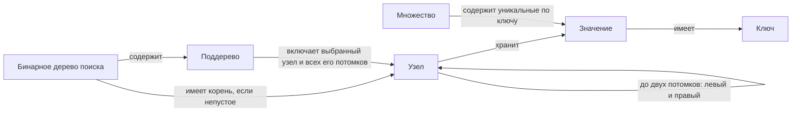
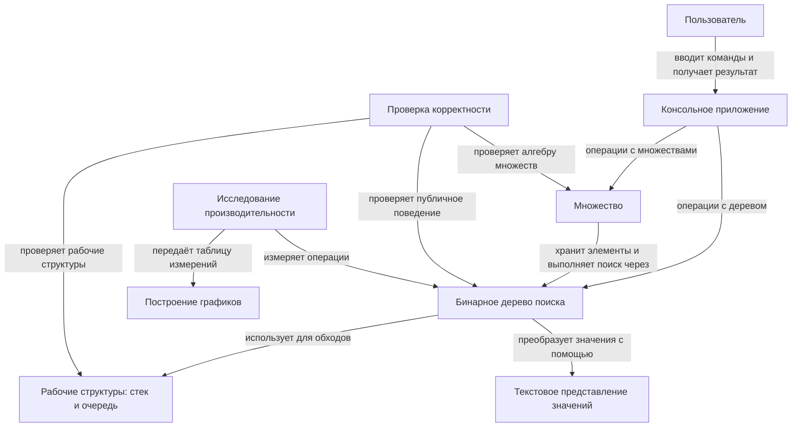
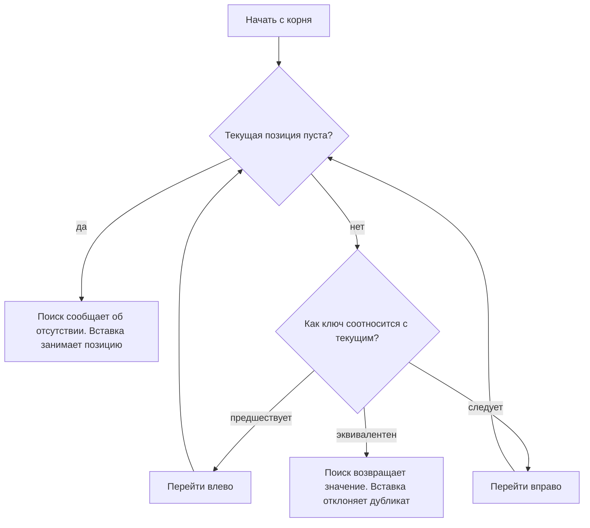
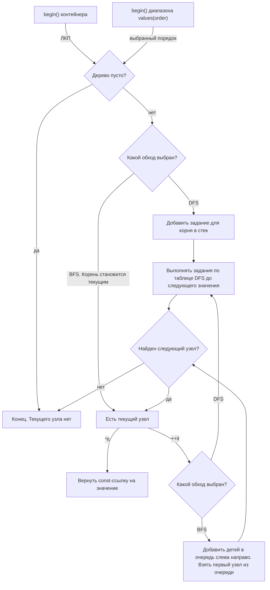

# Дизайн лабораторной работы № 1. Дерево поиска и множество

## 1. Постановка задачи

Разработать библиотеку для работы с бинарным деревом поиска и множеством, а также консольную программу для демонстрации их операций. Библиотека должна поддерживать разные типы значений и заданное пользователем правило сравнения. В демонстрации используются целые и вещественные числа, строки, записи о студентах и комплексные числа.

Дерево поиска подходит для задач, в которых данные пополняются и удаляются, а пользователю нужно находить записи по ключу и просматривать их в заданном порядке. С помощью множеств можно сравнить группы уникальных значений, например найти общие идентификаторы в двух списках или выяснить, какие идентификаторы есть только в первом списке. Извлечение поддерева и восстановление из текста позволяют работать с формой дерева и сохранять её между сеансами.

Выбранные пункты дают **28 баллов**. Из них 15 относятся к дереву, 11 — к множеству и 2 — к перегрузке операторов. Обход в ширину предусмотрен дополнительно для демонстрации.

## 2. Сущности задачи и их связи

| Сущность | Описание |
|---|---|
| Значение | Данные, которые хранятся в контейнере. Например, у записи о студенте есть идентификатор, имя и дата рождения. |
| Ключ и правило сравнения | Ключ определяет, какое место занимает значение в заданном порядке и какие значения считаются эквивалентными. Он может определяться всем значением или его частью. Например, ключ студента определяется идентификатором. |
| Узел | Позиция в дереве, в которой хранится одно значение. У узла есть левое и правое места для потомков, каждое из которых может быть пустым. |
| Бинарное дерево поиска | Иерархия узлов с одним корнем, если дерево непустое. В левой ветви каждого узла находятся ключи, предшествующие его ключу по заданному правилу, в правой — следующие за ним. Условие относится ко всем потомкам, а не только к непосредственным детям. |
| Поддерево | Выбранный узел вместе со всеми его потомками и связями между ними. Пустое дерево считается поддеревом любого дерева. |
| Множество | Группа значений, уникальных по ключу. Равенство и включение множеств определяются их содержимым. |



Два ключа эквивалентны, если ни один из них не предшествует другому. Эквивалентность нужна для поиска, вставки и операций над множествами. При проверке точного вхождения поддерева сравниваются значения целиком. Например, записи с одинаковым ID и разными именами занимают одну позицию по ключу, но не совпадают как значения. Для поиска кандидата на корень предполагается, что равные значения имеют эквивалентные ключи.

## 3. Архитектура и ключевые решения



**Консольное приложение** принимает команды и данные, сообщает об ошибках ввода и показывает результаты. С библиотекой оно работает через публичные операции. Для изображения формы дерева ему достаточно получить значения, глубину и направление ветви. Ядро библиотеки можно подключать отдельно от приложения и средств проверки.

**Дерево поиска.** Поиск и вставка спускаются от корня по одному пути, сравнивая ключ с ключом в текущем узле. Вставка заканчивается в первом свободном месте на этом пути. При удалении лист отсоединяется, узел с одним ребёнком заменяется этим ребёнком, а узел с двумя детьми — узлом с наименьшим ключом в правом поддереве по заданному правилу сравнения. Связи с оставшимися потомками перестраиваются с сохранением порядка ключей. Дерево не балансируется, поэтому форма зависит от последовательности вставки. Вставка, поиск и удаление занимают `O(h)`, где `h` — высота дерева. При последовательной вставке отсортированных ключей дерево может вырасти в цепочку, а построение занять `O(n²)`.

**Обходы и обработка данных.** Стек задаёт порядок отложенных действий в обходах в глубину. Каждый из шести порядков — это перестановка действий «посетить корень», «обойти левую ветвь» и «обойти правую ветвь». Очередь при обходе в ширину обрабатывает узлы по уровням, добавляя левого ребёнка перед правым. Каждый обход посещает `n` узлов за `O(n)`. Дополнительная память зависит от высоты для обхода в глубину и от максимальной ширины уровня для обхода в ширину. Рабочие структуры опираются на расширяемые буферы. Стек использует динамический массив, очередь организует свой буфер как кольцо и сохраняет порядок при расширении.

**Итерация по значениям.** Дерево предоставляет обход по одному элементу за шаг. Итератор сохраняет текущий узел и задания, необходимые для продолжения. Обычный цикл использует ЛКП, а диапазон с явно выбранным порядком поддерживает все семь обходов. Множество получает итератор из своего дерева. Обход с функцией обработки использует тот же диапазон, поэтому порядок посещения в обоих интерфейсах задаётся в одном месте.

**Поддеревья.** При извлечении сначала ищется узел по ключу, затем копируются его ветви с сохранением формы. Для проверки вхождения находится кандидат на корень. Далее соответствующие ветви сравниваются попарно. Совпадение требует равных значений и одинакового присутствия левого и правого потомков на каждой позиции. Копирование, обход и очистка проектируются итеративными, чтобы работать и с глубоким вырожденным деревом.

**Множество** использует дерево поиска как внутреннее хранилище и делегирует ему основные операции. Объединение добавляет значения второго множества к копии первого. Пересечение выбирает из первого значения, присутствующие во втором, а разность — отсутствующие. Для включения проверяется наличие каждого ключа первого множества во втором. Равенство определяется взаимным включением. При операциях над двумя множествами их правила сравнения должны задавать одинаковую эквивалентность ключей.

**Сохранение и восстановление.** При записи в порядке КЛП сначала сохраняется корень, затем левая и правая ветви. Для пустых ветвей предусмотрен отдельный маркер. Он позволяет отличить деревья с одинаковыми значениями и разной формой. Текстовое представление каждого значения задаётся отдельно от представления структуры. Множество имеет свой признак формата и использует представление внутреннего дерева. При чтении для каждого узла проверяются границы, заданные предками, и строится временный результат. Текущий контейнер заменяется после успешной проверки входных данных.

**Проверка и измерения.** Корректность проверяется на пустых и непустых контейнерах, дубликатах, разных порядках сравнения, удалении узлов с разным числом детей, обходах и ошибках восстановления. Для экспериментов отдельно измеряются вставка, поиск и удаление на случайной и отсортированной последовательностях. Подготовка входа выполняется вне замера. Повторы и параметры фиксируются в таблице, по которой строятся графики. Размер и время отдельных сценариев ограничиваются с учётом вырождения дерева.

## 4. Функциональные требования

| Компонент | Действия и особые сценарии | Пункты и баллы |
|---|---|---:|
| Дерево, основные операции | Создать и очистить дерево, вставить, найти и удалить значение. Вставка эквивалентного ключа сохраняет существующее значение. Поиск и удаление отсутствующего ключа сообщают об отсутствии. Удаление поддерживает корень и узлы с нулём, одним или двумя детьми. | 1 — 5 |
| Дерево, обработка | `map` преобразует значения, `where` отбирает их. Обе операции возвращают независимое дерево и сохраняют уникальность ключей. `reduce` сворачивает значения в порядке ЛКП, передавая функции текущий элемент и накопленный результат. Для пустого дерева результат свёртки равен начальной величине. | 1.2 — 3 |
| Дерево, сохранение и чтение | Сохранить форму и значения в строке КЛП, включая пустые ветви. Восстановить дерево из такой строки. Неполные данные, лишние токены при чтении строки, дубликаты и нарушения порядка отклоняются. При ошибке формата прежнее дерево сохраняется. | 1.4.1 — 1, 1.5.1 — 1 |
| Дерево, поддеревья | Извлечь независимую копию поддерева по ключу его корня. При отсутствии ключа сообщить об ошибке. Проверить точное вхождение другого дерева. Совпадение ключей без совпадения значений и формы недостаточно. | 1.6 — 2, 1.7 — 3 |
| Множество | Хранить уникальные ключи на основе собственного дерева поиска. Поддержать добавление, поиск, удаление, просмотр и очистку. | 6.1.2 — 2 |
| Множество, обработка | Выполнить `map`, `where` и `reduce`. Если преобразованные значения имеют эквивалентные ключи, в результате сохраняется одно значение на ключ. | 6.2 — 2 |
| Множество, алгебра | Получить объединение, пересечение и разность. Проверить включение и равенство независимо от формы деревьев. | 6.3 — 2, 6.4 — 2 |
| Множество, сохранение и чтение | Сохранить множество в строку и восстановить из неё. Сообщить об ошибке формата без замены текущего множества. | 6.5 — 3 |
| Операторы | Предоставить операторы алгебры и сравнения множеств, включая составные операции с присваиванием, а также потоковое чтение и запись дерева и множества. | 7.3 — 2 |
| Итерация | Читать значения дерева и множества через обычный цикл в порядке ЛКП или выбрать один из семи обходов. Пустой контейнер даёт пустой диапазон. Значения доступны для чтения. Цикл можно прервать на любом элементе. | Дополнение API |
| Консоль | Дать возможность вводить и генерировать данные, выполнять операции с деревом и множеством, просматривать небольшой BST как иерархию, выбирать режим сохранения и чтения. Команда «Все обходы» показывает шесть обходов в глубину и обход в ширину. При некорректной команде вывести сообщение и вернуть пользователя к выбору действия. | Демонстрация |
| **Итого** | **Дерево — 15, множество — 11, операторы — 2** | **28** |

## Приложение. Разбор алгоритмов дерева на примерах

На схемах `L` означает левую связь, `R` — правую, `∅` — отсутствие узла. В числовых примерах задан обычный порядок по возрастанию. С другим компаратором те же шаги выполняются по заданному им порядку.

### А.1. Поиск и вставка

Поиск начинает с корня и на каждом шаге выбирает одну ветвь. Эквивалентный ключ завершает поиск. Пустая связь означает, что ключа в дереве нет. По этому же пути вставка доходит до места нового узла. Если дерево пустое, вставленный узел становится корнем. Если ключ уже есть, вставка ничего не меняет.



Например, если слева от `8` находится `3`, а справа от `3` находится `6`, путь для ключа `7` будет `8 → 3 → 6 → ∅`. Вставка делает `7` правым ребёнком `6`. Публичный `find` возвращает значение для чтения, если оно найдено, а `contains` возвращает только признак наличия. Оба используют один алгоритм поиска.

### А.2. Удаление

Сначала находится удаляемый узел и запоминается его родитель. Затем выбирается замена для места, которое занимал узел. Если это корень, меняется корневая связь. Иначе меняется левая или правая связь его родителя. При отсутствии ключа дерево остаётся прежним.

**Лист и узел с одним ребёнком.** На следующих схемах две операции применяются независимо к одному исходному дереву.

```text
Исходное дерево     После удаления 3     После удаления 10

8                   8                    8
├─ L: 3             └─ R: 10             ├─ L: 3
└─ R: 10               └─ R: 14          └─ R: 14
   └─ R: 14
```

В первом случае левая связь узла `8` становится пустой. Во втором правая связь начинает вести к единственному ребёнку удалённого узла. Удаление единственного узла, например `[8]`, делает дерево пустым. При удалении корня с одним ребёнком ребёнок становится новым корнем.

**Двое детей, преемник — правый ребёнок.** Преемник — самый левый узел правого поддерева. Здесь у `10` нет левого ребёнка, поэтому `10` сразу поднимается на место `8`. Он получает левую ветвь удаляемого узла и сохраняет свою правую ветвь.

```text
Удаляем 8           Результат

8                   10
├─ L: 3             ├─ L: 3
└─ R: 10            └─ R: 14
   └─ R: 14
```

**Двое детей, преемник расположен глубже.** В примере ниже узел `15` находится по пути `10 → 20 → 15`. Левого ребёнка у `15` нет. Сначала `20` получает правого ребёнка преемника, `17`, на место своей левой ветви. Затем `15` занимает место `10` и получает оставшиеся левую и правую ветви.

```text
Удаляем 10          Результат

10                  15
├─ L: 5             ├─ L: 5
└─ R: 20            └─ R: 20
   ├─ L: 15            ├─ L: 17
   │  └─ R: 17         └─ R: 30
   └─ R: 30
```

Узел-преемник переносится целиком, поэтому значения оставшихся узлов сохраняются на своих местах в памяти. Для удаления не требуется присваивать одно значение другому. Поиск узла и поиск его преемника вместе занимают `O(h)`.

### А.3. Обходы и обработка значений

Для примеров возьмём дерево, в котором уровни заполнены неравномерно.

```text
8
├─ L: 3
│  ├─ L: 1
│  └─ R: 6
│     ├─ L: 4
│     └─ R: 7
└─ R: 10
   └─ R: 14
      └─ L: 13
```

В обходах в глубину в стеке хранятся два вида заданий: обработать значение узла или развернуть поддерево. Для ЛКП сначала надо развернуть левую ветвь, потом обработать значение и затем развернуть правую. Задания кладутся в обратном порядке, чтобы левое оказалось сверху.

```text
Разворачиваем 8 для ЛКП

Верх стека → [обойти 3] → [обработать 8] → [обойти 10]
```

BFS извлекает узел из начала очереди и помещает его детей в конец. Поэтому уже ожидающие узлы текущего уровня обрабатываются раньше детей следующего уровня.

| Посещённый узел | Очередь после посещения, от начала к концу |
|---|---|
| Начальное состояние | `8` |
| 8 | `3, 10` |
| 3 | `10, 1, 6` |
| 10 | `1, 6, 14` |
| 1 | `6, 14` |
| 6 | `14, 4, 7` |
| 14 | `4, 7, 13` |
| 4 → 7 → 13 | Пусто после последнего узла |

| Обход | Результат для дерева на схеме |
|---|---|
| КЛП | `8 3 1 6 4 7 10 14 13` |
| КПЛ | `8 10 14 13 3 6 7 4 1` |
| ЛКП | `1 3 4 6 7 8 10 13 14` |
| ЛПК | `1 4 7 6 3 13 14 10 8` |
| ПКЛ | `14 13 10 8 7 6 4 3 1` |
| ПЛК | `13 14 10 7 4 6 1 3 8` |
| BFS | `8 3 10 1 6 14 4 7 13` |

Структурный проход для CLI также идёт в КЛП. Вместе со значением он передаёт глубину и ветвь от родителя. Например, у `8` глубина `0`, у `3` — `1` и ветвь `L`, у `6` — `2` и ветвь `R`. Для пустого дерева обработчик не вызывается, для одиночного — вызывается один раз.

| Операция | Что происходит на примере |
|---|---|
| `map(x → x mod 2)` | В порядке КЛП создаётся новое дерево. От `8` получается `0`, от `3` — `1`. Остальные результаты повторяются, поэтому остаются два ключа. |
| `where(4 ≤ x ≤ 10)` | В новое дерево вставляются `8, 6, 4, 7, 10` в этом порядке. Его обход ЛКП даёт `4, 6, 7, 8, 10`. |
| `reduce` с суммой и начальным нулём | В порядке ЛКП результат проходит значения `1, 4, 8, 14, 21, 29, 39, 52, 66`. |

### А.4. Копирование, извлечение и проверка поддерева

При копировании узлы создаются заново на соответствующих позициях. Стек хранит пары «узел источника — копия этого узла». Для каждой пары копии потомков присоединяются с той же стороны, что и в источнике, и сами становятся заданиями. При извлечении поддерева работа начинается с узла, найденного по ключу. Например, извлечение от `6` из дерева выше создаёт отдельное дерево `6` с детьми `4` и `7`. Удаление ветви в копии не затрагивает исходное дерево.

При проверке вхождения сначала по ключу ищется кандидат на корень. Затем сравниваются пары соответствующих позиций. Две пустые позиции совпадают. Одна пустая позиция или разные значения дают отказ. Иначе сравниваются левая ветвь с левой и правая с правой.

```text
Ветка в исходном     Точное совпадение     Совпадают ключи, но не форма

10                    10                    10
└─ R: 14              └─ R: 14              └─ R: 13
   └─ L: 13              └─ L: 13              └─ R: 14

                      Входит                Не входит
```

В последнем случае различие видно уже в правой позиции корня. Там в исходной ветви стоит `14`, а в образце — `13`. Если образец пуст, проверка сразу успешна. Если образец непуст и его корень не найден, проверка заканчивается отказом. Для извлечения или проверки поддерева из `k` узлов требуется до `O(h + k)` времени.

### А.5. Запись формы и восстановление

Для дерева `8` с детьми `3` и `10` запись КЛП с пустыми позициями имеет логическую последовательность `8 → 3 → ∅ → ∅ → 10 → ∅ → ∅`. Первые две пустые позиции относятся к детям `3`, последние две — к детям `10`. Без указания пустых позиций порядок КЛП сам по себе не описывает произвольное бинарное дерево. В выбранном формате маркеры явно задают каждую ветвь, и читатель может проверять структуру по мере чтения.

Читатель начинает с места для корня. Для каждого места он хранит сторону от родителя и допустимый интервал ключей. При чтении узла появляются два новых места. Правое кладётся в стек первым, чтобы следующим прочитать левое в порядке КЛП. Пустой маркер закрывает место сразу.

```text
8                          корень без границ
└─ L: 3                    допустимый ключ меньше 8
   └─ R: ?                 допустимый ключ больше 3 и меньше 8

   6 подходит             9 нарушает границу, заданную узлом 8
```

Так проверяется порядок относительно дальних предков. Совпадение с одной из строгих границ также недопустимо. Если данные закончились раньше, чем заполнены все места, запись неполная. При восстановлении целой строки остаток после последнего места тоже считается ошибкой. Проверенное дерево заменяет текущее, поэтому ошибка формата не повреждает прежние данные.

### А.6. Очистка глубокого дерева

Очистка повторяет два шага. Если у корня есть левая ветвь, её корень поднимается правым поворотом. Иначе текущий корень отсоединяется, а оставшаяся правая ветвь становится новым деревом. Перед освобождением отсоединённого узла у него уже нет обеих связей с потомками.

```text
До поворота         После поворота     После отсоединения 3

8                   3                  8
├─ L: 3             └─ R: 8            ├─ L: 6
│  └─ R: 6             ├─ L: 6         └─ R: 10
└─ R: 10               └─ R: 10
```

Поворот переносит ветвь `6` на левую сторону `8`. Так ни один оставшийся узел не теряется. Правая цепочка очищается без поворотов, левая — с подъёмом её узлов. Алгоритм занимает `O(n)` времени и `O(1)` дополнительной памяти. Глубина дерева не увеличивает глубину вызовов.

### А.7. Итераторы дерева и множества

`begin()` подготавливает первое значение в ЛКП. Для другого порядка `values(order)` создаёт диапазон, который хранит ссылку на контейнер и выбранный порядок. Обход начинается при вызове `begin()` у диапазона. `end()` обозначает отсутствие текущего узла.



В BFS первым текущим узлом становится корень. Только при `++it` его дети попадают в очередь. Для DFS стек хранит два вида заданий из раздела А.3. Итератор останавливается на задании обработки значения, а оставшиеся задания ждут следующего шага. Например, на дереве из А.3 первый шаг ЛКП доходит до `1` и оставляет в стеке путь к следующим значениям. Если цикл завершится на `1`, правое поддерево корня обходить не понадобится.

Значения читаются по `const T&`, поэтому можно обходить дерево без копирования элементов. Копии итератора хранят самостоятельные стек или очередь и продвигаются независимо. Полный проход за `O(n)` использует до `O(h)` памяти для DFS или `O(w)` для BFS, где `h` — высота дерева, а `w` — максимальная ширина уровня. Постфиксное `it++` сохраняет прежнюю позицию вместе с состоянием обхода. Если прежняя позиция не нужна, достаточно `++it`.

Контейнер должен существовать до конца обхода. После структурного изменения нужно получить новый итератор. Итератор конца сравнивают с текущей позицией, разыменовывают только позиции с узлом.
